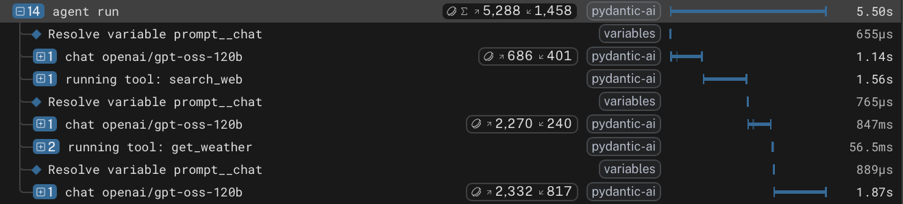
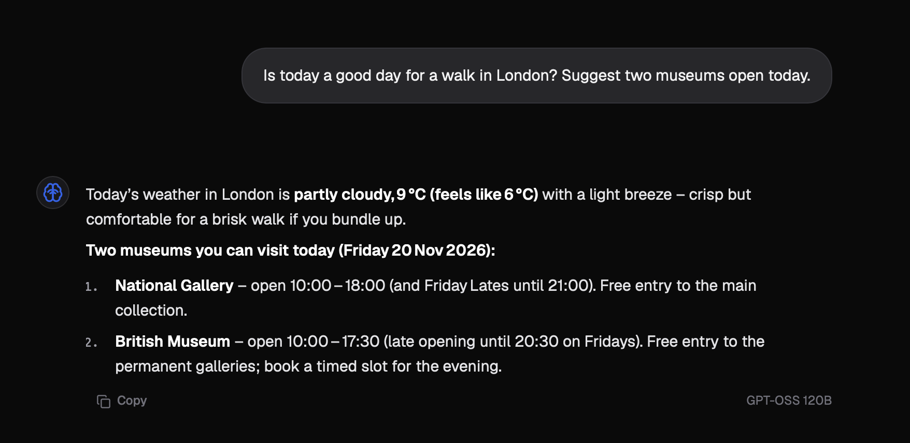
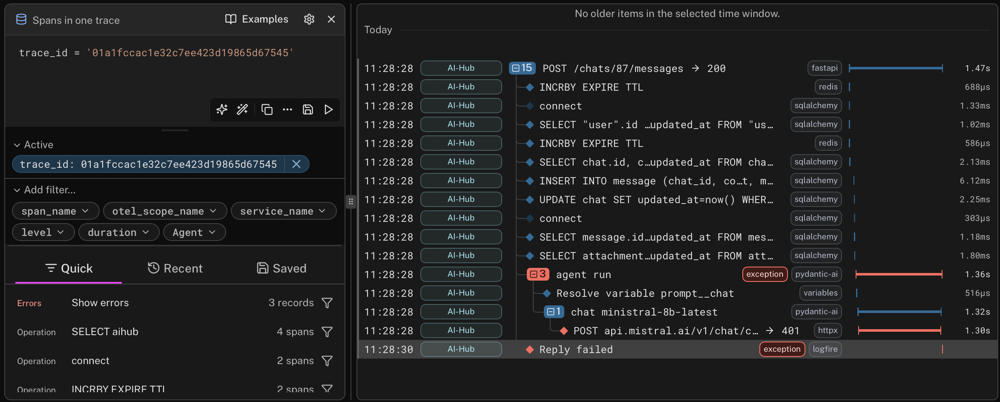

# AI-Hub

[](https://github.com/mekanbaymyradov/ai-hub/actions/workflows/ci.yml)
[](pyproject.toml)
[](LICENSE)
[](https://github.com/astral-sh/ruff)

A chat app for LLMs that I built to learn how FastAPI serves AI agents, and
run like a production service.

**Live:** [ai-hub.techship.fun](https://ai-hub.techship.fun/)



*One reply in production: the agent searches the web and checks the weather
before it answers.*

## Highlights

- Pydantic AI agents [stream replies through FastAPI](docs/architecture.md#streaming)
  in the Vercel AI SDK's protocol, with web search, weather and time tools.
- Every request is [traced in Logfire](docs/architecture.md#logging-and-observability).
  Production traces leave out users' messages and the model's replies.
- The prompt lives in Logfire, and [evals](docs/architecture.md#prompt-and-evals)
  score each new version before it ships. The current one raised "answers
  first" from 69% to 90%.
- Failed replies and 5xx responses return an
  [Error ID](docs/debugging-a-failed-reply.md). The user can report it, and it
  opens the trace.
- Refresh tokens [rotate on every use](src/auth/sessions.py); reusing an old
  one ends the session.
- One [dashboard](docs/architecture.md#logging-and-observability) and ten
  alerts cover product and system health.

## In the app



*A reply in the app, with the model's thought process collapsed above it.*

## When a reply fails



*Searching Logfire for a user's Error ID: Mistral rejected the API key.*

## Architecture

Everything runs with Docker Compose on one server, and a version tag deploys it.


## Tech stack

- **Backend:** FastAPI, Pydantic, SQLAlchemy (async), Alembic, PostgreSQL, Redis
- **LLM:** Pydantic AI, pydantic_evals, Tavily
- **Observability:** OpenTelemetry (GenAI semantic conventions), Logfire
  (traces, dashboards, alerts, managed prompts, Fleet), OpenTelemetry Collector
- **Infrastructure:** Docker Compose, Caddy, Cloudflare R2, Resend, supercronic, uv
- **CI/CD:** GitHub Actions for lint, types, tests and a Compose smoke test

## Getting started

Needs [Docker](https://docs.docker.com/get-docker/) and [uv](https://docs.astral.sh/uv/).

```bash
cp .env.example .env    # then fill in the keys, see docs/development.md
docker compose -f docker-compose.dev.yaml --profile frontend up --watch

# in a second terminal
uv run alembic upgrade head
```

- App: http://localhost:5173
- API docs: http://localhost:8000/docs

Run the tests with `uv run pytest`, and the evals with
`uv run python -m evals --name <run> --label candidate` (needs Groq and Logfire
keys, see [docs/development.md](docs/development.md)).

## Docs

- [Development guide](docs/development.md): setup, migrations, jobs, tests
- [Architecture](docs/architecture.md): how each part works
- [Debugging a failed reply](docs/debugging-a-failed-reply.md): from a user's report to the fix

## Credits

I built the backend, infrastructure, evals and tests;
[yunus770](https://github.com/yunus770) built most of the React web app.

Inspired by:

- [Netflix Dispatch](https://github.com/Netflix/dispatch/tree/main/src/dispatch): one package per domain
- [FastAPI Best Practices](https://github.com/zhanymkanov/fastapi-best-practices) by [@zhanymkanov](https://github.com/zhanymkanov)
- [FastAPI Tips](https://github.com/Kludex/fastapi-tips) by [@Kludex](https://github.com/Kludex)
