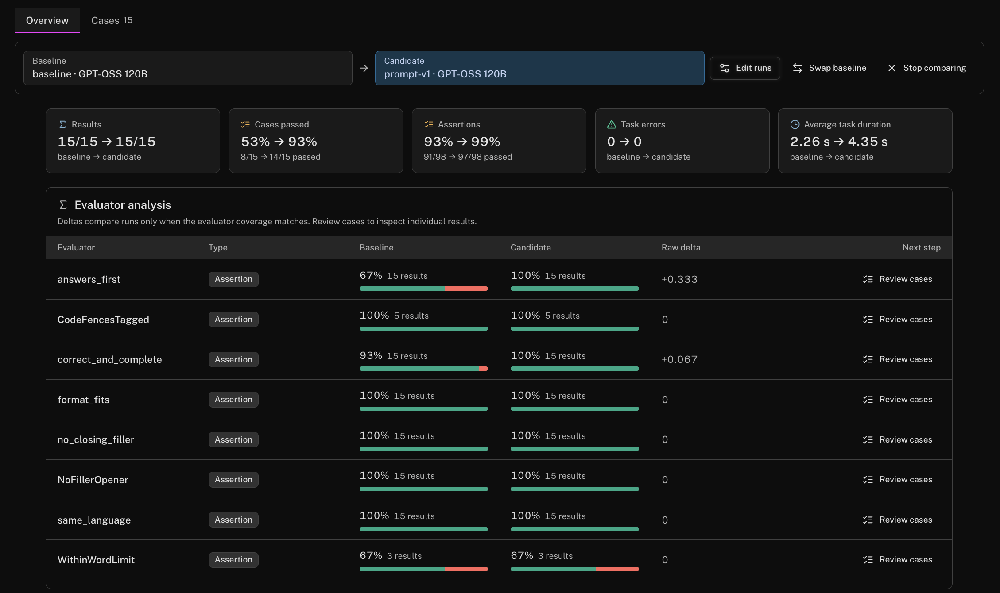
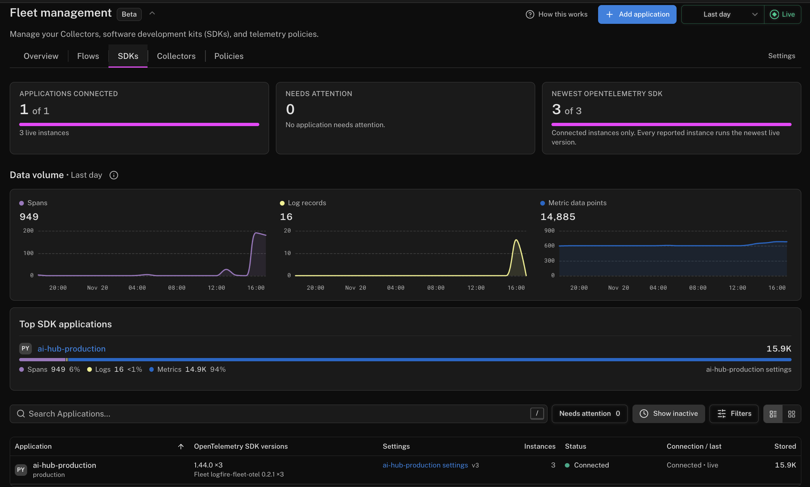

# Architecture

The code is split by domain under `src/`: `auth`, `chat`, `llm`,
`notifications` and `voice`. Each has its own `router`, `service`, `flows`,
`models` and `config` modules as it needs them. Shared code sits at the top of
`src/`.

## Auth

`src/auth/`. Sign-in is passwordless:

1. `POST /auth/otp/request` emails a 6-digit code. It lives in Redis for 5
   minutes and allows 5 attempts.
2. `POST /auth/otp/verify` exchanges it for a 15-minute access JWT and a
   30-day refresh token.

Sessions live in Redis, which stores only a hash of each refresh token. Every
refresh rotates both tokens. Reusing an old refresh token means it was stolen,
so the whole session is revoked (`src/auth/sessions.py`).

## LLM registry

`src/llm/registry.py`. At startup, a Pydantic AI model is built for each
provider that has an API key. The catalog is served at `GET /llms/models`.

## Streaming

`POST /chats/{chat_id}/messages` streams the reply in the Vercel AI SDK's
protocol, through Pydantic AI's `VercelAIAdapter` (`src/chat/adapter.py`).

- **History:** the database holds the only copy. The client sends just the new
  message, which is stored before the run.
- **Saving:** the reply is stored when the run completes. A new chat gets its
  title then, streamed as a `data-chat-name` chunk.
- **Reasoning:** a message's `effort` (`low`, `medium` or `high`) becomes the
  run's `thinking` setting. Reasoning is streamed and stored, but left out of
  the transcript.
- **Errors:** `ChatEventStream.on_error` logs the failure and sends an error
  body without the provider's message. The body carries the reply's
  `trace_id`, which the chat shows as the Error ID.

## Agent tools

`src/llm/tools.py`. The chat agent can tell the time, check the weather
(Open-Meteo) and search the web.

- **Web search:** Claude and Gemini use their provider's built-in search. Other
  models get `search_web`, which calls Tavily and needs `TAVILY_API_KEY`.
  Built-in search is an allowlist (`_native_web_search`), because Pydantic AI
  wrongly reports it for every Groq model.
- **Errors:** a tool raises `ModelRetry` when the model should fix its
  arguments, like an unknown city, and `ToolFailed` when retrying can't help,
  like a service being down. Both go back to the model instead of failing the
  reply. Before this, a failed web search failed the whole reply, and 4 of 15
  did.
- **Descriptions:** the model reads a tool's docstring, so it is written for
  the model.
- **HTTP:** tools share one `httpx2` client from the app's lifespan, so tests
  swap in a `MockTransport`.
- **Streaming:** replies run with `run_stream_events()`, so a tool call that
  follows text still runs. Tool calls stream to the client and are stored with
  the chat, but left out of its transcript.

## Prompt and evals

The chat prompt is the managed prompt `chat` in Logfire. It changes and rolls
back without a deploy, and evals score each version before it goes live.

- **Prompt:** the app fetches it at startup, since the first fetch can take up
  to 20 seconds. Logfire pushes later changes into memory. Replies use the
  `production` label, and the copy in `src/llm/agents.py` is used when Logfire
  can't serve one. Each reply's trace records the prompt's label and version.
- **Instructions:** each run joins four parts: the guidance from Logfire, the
  model's name and today's date, the user's name, and their custom
  instructions. When the user's instructions conflict with the guidance,
  theirs win.
- **Evals:** `evals/` asks every model with a key 15 questions in 5 languages
  (`evals/cases.yaml`). Code checks (filler openers, code fence tags, word
  limits) and a GPT-OSS 120B judge (answers first, format, language, closing
  filler, correctness) score each answer. Each model's run is a Logfire
  experiment that records the prompt version.
- **Changing the prompt:**
  1. Save a new version of `chat` in Logfire and point `candidate` at it.
  2. Run `uv run python -m evals --name <name> --label candidate`.
  3. If it beats `production`, move `production` to it. Moving the label back
     rolls it back.

| Run | Prompt | Answers first | Correct and complete |
|---|---|---|---|
| baseline, Nov 10 | The old one-line prompt | 41/59 (69%) | 56/59 |
| v1, Nov 11 | First draft of the guidance, never shipped | 37/60 (62%) | 58/60 |
| prompt-v1, Nov 16 | The guidance now in `production` | 54/60 (90%) | 56/60 |

The guidance costs time: on GPT-OSS 120B, answers took 4.4 s on average
instead of 2.3 s.

## Attachments

`src/chat/`. A message can carry up to 5 images or PDFs of 10 MiB each.

1. **Upload:** `POST /chats/attachments` stores the files in the private bucket
   before the message is sent.
2. **Claim:** the message sends the returned ids as `attachment_ids`. Each id
   can be claimed once.
3. **Read:** files are served through signed URLs that expire after 15
   minutes.
4. **Clean up:** an hourly job (`src/chat/schedule.py`) deletes uploads still
   unclaimed after 24 hours. It deletes rows before files, so it never removes
   a file a message is claiming. Files left without a row are swept by the same
   job.

Deleting a chat also deletes its files.

## Voice

`src/voice/`. `POST /voice/transcriptions` turns one recording into text for
the chat input. Nothing is stored.

- **Provider:** Groq's `whisper-large-v3-turbo`, called directly, since
  Pydantic AI has no speech-to-text API. Without `GROQ_API_KEY` the route
  returns 503.
- **Input:** WebM, Ogg, MP4, M4A, MP3, WAV or FLAC, up to 10 MiB.
- **Errors:** audio Groq rejects becomes a 422, so the user records again.
  Groq's 429 becomes a 503 with `Retry-After`, and anything else a 502.
- **Limits:** every user shares Groq's quota, so a per-user rate limit keeps
  one user from using it up.

## Rate limiting

`src/rate_limit.py`. A fixed-window counter in Redis.

- **App-wide:** 100 requests a minute per signed-in user, 60 per IP otherwise.
- **Expensive routes** add their own limit:

  | Route | Limit |
  |---|---|
  | Request a sign-in code | 5 per hour per IP |
  | Exchange a code | 10 per 15 minutes per IP |
  | Upload files | 30 per minute per user |
  | Send a message | 20 per minute per user |
  | Transcribe audio | 10 per minute per user |

- **Response:** a 429 with `Retry-After`.
- **Monitoring:** a request the app-wide limit rejects gets `rate_limit.global`
  on its span (`user:42` or `ip:…`). The *Global rate limit reached* alert
  watches it.
- **Failure:** if Redis is down, the limiter lets requests through and logs a
  warning.

## Pagination

`src/pagination.py`. Lists use cursor pagination. `?limit=` takes 1–100
(default 20), and `?cursor=` takes the previous page's `next_cursor`, which is
`null` on the last page. Cursors are opaque, and one list's cursor is rejected
by another.

## Logging and observability

Code logs only through Logfire, like `logfire.info()`, never through `logging`
(`src/observability.py`).

- **Traces:** each request is one trace, with its SQL, Redis, R2, outgoing HTTP
  and Pydantic AI calls as child spans. Each cron job is one `Job run` trace.
  Signed-in requests carry `user_id`, so one filter finds a user's requests.

  
- **Logs:** a log attaches to its span, so it shares the request's trace ID. A
  failed reply or a 5xx returns that ID as `trace_id` (`error_body` in
  `src/error_handlers.py`).
- **Naming:** every message is a fixed template like `"Reply failed"`, with
  values as attributes. No f-strings, because unique messages break grouping
  and alerts.
- **Console:** production prints only warnings and errors. Failed spans are
  looked up in Logfire.
- **Containers:** an OpenTelemetry Collector sends each container's CPU, memory
  and restarts to Logfire ([`deploy/otel-collector.yaml`](../deploy/otel-collector.yaml)).
- **Fleet:** the app connects to Logfire Fleet, so sampling and log levels
  change without a redeploy. The collector reports its health to Fleet, but
  its config stays in git.

  
- **Privacy:** production traces carry no chat text, only model, tokens and
  timing. Request spans keep only validation errors, without the rejected input
  (`request_attributes_mapper`). Outgoing URLs lose their query string, since
  tools put user input there, like a city (`drop_url_query`). Users are
  identified by ID, never by email.

  
- **Dashboard:** the *AI-Hub* Logfire dashboard puts product numbers (active
  users, LLM cost per user and model, time to first token) next to system
  health (errors, latency per release, containers, the DB pool, sign-ins and
  cron jobs). Ten alerts watch the same data.

  
