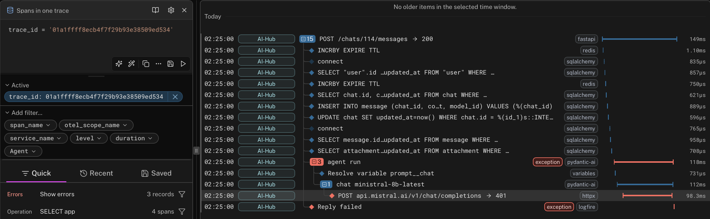

# Debugging a failed reply

How a user's failed reply is traced to its cause. The example is a real failure
from 2026-11-22.

## What the user sees


The error never shows the provider's message. The Error ID is the failed
request's trace ID, and the trace has the cause.

## 1. Open the trace

Ask the user for the Error ID; a screenshot works. In Logfire's Live view,
filter by it:

```sql
trace_id = '01a1ffff8ecb4f7f29b93e38509ed534'
```

Logfire keeps 30 days of data, so an older ID finds nothing.

## 2. Read the trace



The red span is the call to Mistral. It answered 401 in 98 ms, so Mistral
rejected our API key before reading the message. The user did nothing wrong.

## 3. Name the cause

The status code in the `Reply failed` log decides the fix and what the user
hears.

| Cause | Fix | Tell the user |
|---|---|---|
| `401`: our API key was rejected | Replace the key in `/opt/ai-hub/.env`, then `docker compose up -d --force-recreate app` | "That model is down on our side. Use **Try another model** for now; I'll let you know when it's back." |
| `403`: our plan doesn't include the model | Remove it from the catalog in [`src/llm/models.py`](../src/llm/models.py) | "That model is no longer available. Please pick another one." |
| `404`: the model was renamed or retired | Update or remove it in the catalog | The same as for 403 |
| `429`: the provider's rate limit or quota | Usually nothing; if it lasts, check the quota | "That model is busy. Try again in a minute, or pick another one." |
| `5xx`: the provider is down | Check its status page | "The model's provider is having problems. Please pick another model for now." |

## 4. Confirm the fix

Send a message with the same model on the live site, and check that its trace
has no `Reply failed`. Then reply to the user.

<details>
<summary><b>No Error ID?</b></summary>

The Error ID is gone once the page reloads. Find the user's failed replies by
their ID instead. Traces never carry emails, so look the ID up on the server:

```bash
cd /opt/ai-hub
docker compose exec postgres sh -c 'psql -U "$POSTGRES_USER" -d "$POSTGRES_DB"'
```

```sql
SELECT id FROM "user" WHERE email = 'user@example.com';
```

A streamed reply has already returned 200 when the model fails, so search for
the `Reply failed` log, not a 500. It shares a trace with the request span,
which carries the user's ID. In Logfire's Explore view:

```sql
SELECT req.start_timestamp, req.trace_id, fail.attributes->>'model_id' AS model,
       fail.exception_message AS cause
FROM records fail
JOIN records req ON req.trace_id = fail.trace_id AND req.parent_span_id IS NULL
WHERE fail.deployment_environment = 'production'
  AND fail.span_name = 'Reply failed'
  AND req.attributes->>'user_id' = '1'
ORDER BY req.start_timestamp DESC
LIMIT 20
```

Open a row's `trace_id` and continue from step 2.

</details>

## Alerts usually get there first

Two Logfire alerts watch `Reply failed`:

- **🔴 Chat replies failing** runs every 10 minutes and names the model and
  cause for anything we have to fix: 401, 403, 404 and unexpected errors.
- **🟡 LLM provider limits** reports 429s and 5xx after 5 in an hour, since a
  one-off limit is normal on a free tier.
