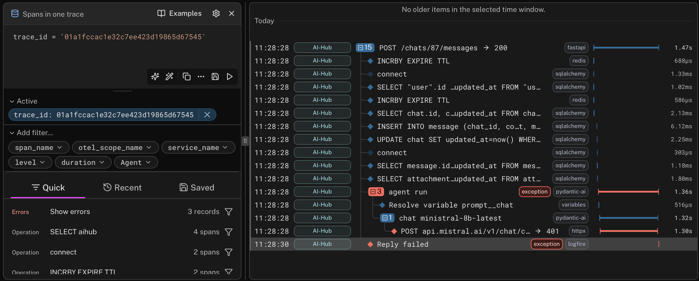

# Debugging a failed reply

From a user's report to the fix, using a real failure from 2026-11-22.

## What the user sees



The error hides the provider's message. The Error ID is the request's trace ID.

## 1. Open the trace

Ask the user for the Error ID. A screenshot works. In Logfire's Live view,
filter by it:

```sql
trace_id = '01a1ffff8ecb4f7f29b93e38509ed534'
```

Logfire keeps 30 days of data.

## 2. Read the trace


The call to Mistral answered 401: our API key was rejected. The user did
nothing wrong.

## 3. Name the cause

The status code decides the fix and what to tell the user.

| Status | Fix | Tell the user |
|---|---|---|
| `401` bad API key | Replace the key in `/opt/ai-hub/.env`, then `docker compose up -d --force-recreate app` | "That model is down on our side. Please try another model for now." |
| `403` not in our plan | Remove it from the catalog in [`src/llm/models.py`](../src/llm/models.py) | "That model is no longer available. Please pick another one." |
| `404` model renamed or retired | Update or remove it in the catalog | The same as for 403 |
| `429` rate limit or quota | Usually nothing. If it lasts, check the quota | "That model is busy. Try again in a minute, or pick another one." |
| `5xx` provider down | Check its status page | "The provider is having problems. Please try another model for now." |

## 4. Confirm the fix

Send a message with the same model. If its trace has no `Reply failed`, reply
to the user.

<details>
<summary><b>No Error ID?</b></summary>

The Error ID is gone once the page reloads. Find the user's ID on the server
instead, since traces never carry emails:

```bash
cd /opt/ai-hub
docker compose exec postgres sh -c 'psql -U "$POSTGRES_USER" -d "$POSTGRES_DB"'
```

```sql
SELECT id FROM "user" WHERE email = 'user@example.com';
```

Then list their failed replies in Logfire's Explore view. A streamed reply
returns 200 before the model fails, so look for `Reply failed`, not a 500:

```sql
SELECT req.start_timestamp, req.trace_id, fail.attributes->>'model_id' AS model,
       fail.exception_message AS cause
FROM records fail
JOIN records req ON req.trace_id = fail.trace_id AND req.parent_span_id IS NULL
WHERE fail.deployment_environment = 'production'
  AND fail.span_name = 'Reply failed'
  AND req.attributes->>'user_id' = '1'
ORDER BY req.start_timestamp DESC
LIMIT 20
```

Open a row's `trace_id` and continue from step 2.

</details>

## Alerts

Two Logfire alerts watch `Reply failed`, so most failures show up before a user
writes in:

- **🔴 Chat replies failing** runs every 10 minutes and names the model and
  cause of anything we have to fix: 401, 403, 404 and unexpected errors.
- **🟡 LLM provider limits** reports 429s and 5xx after 5 in an hour, since a
  one-off limit is normal on a free tier.
